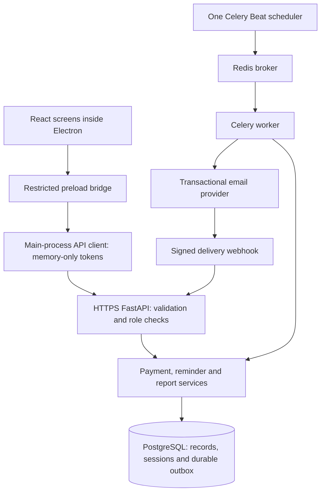

# Architecture and build order

1. Create the database and configuration.
2. Apply versioned schema migrations.
3. Start and verify the backend connection.
4. Create the initial administrator and enroll MFA.
5. Create company billing records and invoices.
6. Record verified payments and check outstanding balances.
7. Validate the API/business rules using the automated suite.
8. Start the React interface and connect it through Electron's bridge.
9. Preview reminder candidates, start the worker/scheduler, then configure live email.
10. Inspect monthly chart counts and drill down to company records.
11. Package and verify each target operating system.
12. Pilot, rehearse backup restoration, and enable the real monthly policy.

## Data model

- `app_users` → `auth_sessions` and `auth_tokens`.
- `companies` → `invoices` → `payments`.
- `reminder_policies` configures the single monthly schedule.
- `reminder_runs` → `reminders` → `delivery_attempts`.
- `reminder_items` connects each reminder to the exact invoice cohort mentioned.
- `outbox_events` persists work alongside business transactions.
- `email_webhook_events` deduplicates signed external events, including early/out-of-order delivery events.
- `audit_logs` records important actions and corrections.
- `rate_limits` stores shared fixed-window counters and a worker heartbeat.

Version 1 stores one primary billing contact on the company row, rather than introducing a multi-contact workflow. It supports one business and INR. Separate contact/tenant models can be introduced through new migrations when required.

## Payment transaction

The request is identified by an idempotency key and normalized payload hash. An invoice version update takes a database write lock. The balance is rechecked after acquiring that lock, then the payment and audit event commit together. A retried identical request returns the existing result. A different payload using that key returns a conflict.

## Reminder transaction

A preview has no delivery side effects. Queueing saves a run, a unique company/month reminder, invoice links, and an outbox event. A worker claims due work, rechecks balances, persists its prepared request before external I/O, and records acceptance/failure. A stopped worker or ambiguous response becomes UNKNOWN and requires provider-history review. Delivery events are verified over the raw body and cannot downgrade a delivered message to queued/sent.

## Runtime boundaries

The desktop never receives database/email/encryption credentials. The renderer has no Node access and cannot navigate to arbitrary pages. The main process permits only allowlisted API routes and HTTPS remote origins. The API checks permissions regardless of which client sent the request.

The server is independent of installed desktops. Local demo mode is a development convenience that uses SQLite and a preview-only worker; it is not the production scheduling topology.
